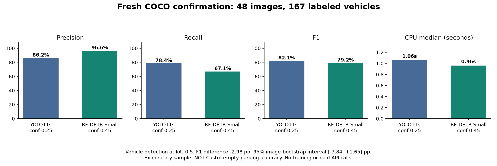

# Vehicle detector evaluation — 24 October 2026 (America/Los_Angeles)

**Decision: retain YOLO11s. No overall detection improvement was established.**
The candidate reduced false boxes but missed more vehicles. Missing cars can
lead to false-open parking results; this tradeoff does not justify promotion.
No production detector or shared Convex occupancy/schema behavior was changed.
No model training, paid inference API, cloud training or production ingestion
was used for this evaluation. The live ASI agent checkout was kept separate.

## Fresh confirmation (48 images, 167 labeled vehicles)

| Metric | Retained YOLO11s | RF-DETR Small, calibrated |
|---|---:|---:|
| Input size / confidence | 1280 / 0.25 | 512 / 0.45 |
| Correct vehicle matches | 131 | 112 |
| False boxes | 21 | 4 |
| Missed vehicles | 36 | 55 |
| Precision | 86.18% | 96.55% |
| Recall | 78.44% | 67.07% |
| F1 | 82.13% | 79.15% |
| Median CPU wall time | 1.058 s | 0.961 s |
| p95 CPU wall time | 1.180 s | 1.008 s |

F1 changed **-2.98 percentage points**. The exploratory paired-image bootstrap
95% interval is **[-7.84, +1.65] pp** (2,000 resamples, seed 20261024).
False boxes fell 81.0%, while misses increased 52.8%; precision alone hides that
regression. Timings are local desktop measurements, not a deployment SLA.

## Method and unsuccessful pilot

Official human COCO val2017 annotations supply ground truth for pooled vehicles
(car, motorcycle, bus, truck). Score-sorted predictions are matched one-to-one
at IoU >= 0.5. Duplicate boxes count as false positives; crowd regions are
ignored by intersection-over-prediction-area after matching non-crowd truth.
This is vehicle-family F1, **not COCO mAP, curb legality or parking accuracy**.
COCO val2017 may already have been used by model vendors for evaluation; these
images were held out from our configuration selection, not a new unseen domain.

The pilot used 48 images (36 positive, 12 negative): 16 validation images with
31 vehicles and 32 test images with 73 vehicles. Validation F1 scores were:

| Configuration (confidence 0.25) | Validation F1 |
|---|---:|
| YOLO11s, 1280 | 65.57% |
| YOLO26m, 1280 | 63.33% |
| YOLO26s, 1280 + 320-pixel tiles | 52.27% |
| YOLO26m-seg boxes, 1280 | 62.86% |
| RF-DETR Small, native 512 | 75.00% |

The validation winner was frozen before pilot test inference. On that pilot
test, RF-DETR at 0.25 lowered F1 from 72.97% to 66.67% despite reducing misses
from 19 to 12. This failed result is preserved in `pilot-report.json`.

A second, explicit phase swept only the original validation predictions at six
fixed thresholds (0.25/0.35/0.45/0.55/0.65/0.75). It selected 0.45 (validation
F1 84.75%) before fresh confirmation inference. Confirmation used seed 20261025,
48 new images (36 positive, 12 negative), excluding **all 48 pilot image IDs**.
There was one fresh confirmation attempt; its result was not used to retune.
This small, sequential exploration warrants caution, not a general accuracy claim.
The exact splits, hashes, boxes, counts, threshold sweep and failed pilot are
included as JSON. Raw image bytes and model binaries are not committed.

## Camera snapshot limitations

Separately captured 22 unique 960x540 public cloud-preview frames from cameras
1, 2 and 5, around 20:09–20:14 on 24 October. Stored model occupancy and hold
states were excluded as label sources. Capture freezes polygons and skips
calibration changes. These are downsampled previews, not full-resolution video.

The snapshot has eight marked stalls; two polygons touch the frame edge
(C2-1 and C5-2). Blind visual review also found C2-2 over sidewalk/foliage and
foreground bus occlusion in camera 1. All require human review; even a polygon
without geometry warnings is not certified legal or visible. These observations
refer to the captured snapshot, not a claim about the latest live calibration.
No audited vacancy labels were available, so **parking-availability improvement
remains unmeasured**. Camera overlay JSON is qualitative and never used as truth.

## Delivered behavior and checks

- Keep YOLO11s as default; optional YOLO26, segmentation-box and RF-DETR adapters.
- Preserve full-frame normalized `[x1,y1,x2,y2,confidence]` ingest coordinates.
- Keep tiled refinement opt-in: it increased false positives in the pilot.
- Cache a frame only after successful inference/upload; failed frames can retry.
- Add guarded offline replay, independent evaluation, calibration diagnostics,
  reproducible metrics, camera overlays and the chart.
- Merge latest main (6781353), preserving the team's map and voice work.
- 25 offline unit tests passed; `pip check` and `git diff --check` passed.
- Optional RF-DETR ran through `poll.py` on offline camera-5 replay, finding three
  boxes with no backend calls or writes. Three-camera overlays were rendered.
- Saved confirmation counts were recomputed from committed predictions and
  human-label manifests and matched the report exactly.

Environment: Windows 11, Python 3.13.4, Intel CPU, 4 timed inference threads,
PyTorch 2.10.0+cpu; full package versions in `environment.json`. Official weight
sources and hashes are recorded in `model-sources.json`. YOLO release asset
digests and RF-DETR's official registry MD5 were checked. Latency includes
preprocessing, inference and box conversion, excludes decoding and warmups.
The pilot YOLO26m p95 contains a 311-second wall-clock outlier; it is retained,
not silently discarded, and should not be treated as steady-state performance.

## Next step for actual parking accuracy

Nathan should review legal curb polygons and label visible open/taken/unknown
states across complete daylight/night time blocks. Hold out different time
blocks for testing. Compare false-open errors and missed parked vehicles using
the actual temporal backend decision before swapping the default or training
on camera-specific labels. No new model training has been started.

Reproduction commands and CPU setup: [worker/README.md](../../worker/README.md).
After the pilot and fresh confirmation, render with
`python worker/plot_evaluation.py`. Local outputs and caches stay on D: in this
checkout. All code, documentation and Git communication are in English.

Primary references: [YOLO26](https://docs.ultralytics.com/models/yolo26/),
[RF-DETR and licenses](https://github.com/roboflow/rf-detr),
[COCO detection data](https://cocodataset.org/dataset/detection-2017.htm).
Image attribution links and individual licenses accompany each manifest.
